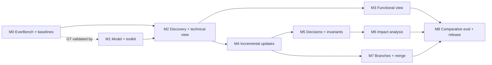

# Evermap Roadmap

Status: Draft v0.1 · 2026-11-25

The milestones are ordered so that measurement comes before functionality. EverBench is built
first (M0), and every later milestone is accepted by measured criteria, not demos.

**Threshold policy.** Numeric thresholds marked *(prov.)* are provisional. After M0 measures the
A0 and A1 baselines, the maintainer reviews them once and freezes them in this file
(pre-registration) before any milestone's evaluation runs. Thresholds marked *(hard)* never
change: they are safety or correctness properties.

---

## Entry criteria for M0 (the first implementation milestone)

M0 starts only when all of these hold:

- [ ] SPEC.md, MODEL.md, BENCHMARK.md and this roadmap have been reviewed and accepted by the
  maintainer. Their decision table (SPEC §9) is confirmed or amended.
- [x] Q1 licence: **Apache-2.0** (decided 2026-11-25; `LICENSE` added).
- [x] Q6 fixture database: **PGlite / Postgres** (decided 2026-11-25).
- [x] Q7 agents: **Claude Code and Codex CLI**, both from M0 (decided 2026-11-25).
- [x] Q8 annotation method: **two headless judges with cross-vendor checks**, settled by
  executable checks; the maintainer reviews disagreements plus a ~10% sample (decided
  2026-11-25).
- [ ] Q7 model versions and the run budget, recorded in the M0 run manifest.
- [ ] Q13 benchmark host: a machine where **both** CLIs are installed and authenticated. The
  current cloud container has Claude Code only.
- [ ] Each judge CLI completes a smoke run that returns schema-valid output (`codex exec
  --output-schema`; Claude Code JSON result validated against the same schema).
- [ ] The planted-property list (BENCHMARK §2.1) and the scenario list (§4) are accepted as the
  M0 scope. Changes after this point go through a changelog.
- [ ] A canary GUID has been generated and recorded.
- [ ] Budget confirmed for at least 5 repetitions × 3 arms × 2 agents × the M0 scenario subset.

---

## M0 — EverBench foundation and baselines

**Deliverables:**

- `bench/fixtures/booking/`: the base snapshot and patches p1–p6, with planted properties
  P1–P18.
- `bench/oracle/`:
  - GT model for the base state and every patch state;
  - expected change sets;
  - risk labels;
  - decision interview and GT decision records;
  - Q&A set;
  - hidden tests;
  - rubrics.
- `bench/harness/`:
  - fixture builder and sandbox;
  - agent adapters for **Claude Code** and **Codex**;
  - the headless judge pipeline (annotation and grading prompts, output schemas,
    reconciliation);
  - matcher, deterministic graders, report generator.
- `bench/oracle/adjudication/`: the maintainer's review log.
- Baseline runs for arms A0 and A1, on **both agents**, on S01, S02, S09–S12, S15–S18, T1–T5 and
  Q&A.

**Acceptance criteria:**

| # | Criterion | Threshold |
| --- | --- | --- |
| M0.1 | Fixture builds deterministically: two builds on different machines produce identical commit SHAs for every state | identical *(hard)* |
| M0.2 | Fixture visible test suite passes at every state | 100% *(hard)* |
| M0.3 | Each verified-risk label (P2, P5, P6) has an oracle test that fails on the unfixed code. Each decoy (P7, P8) has an adversarial test that passes. | 100% *(hard)* |
| M0.4 | Hidden tests for T1–T5 pass on a reference solution and fail on the unmodified base | 100% *(hard)* |
| M0.5 | Judge agreement (J1 Claude Code vs J2 Codex) before adjudication: element F1 and κ on risk tiers | element F1 ≥ 0.85; κ ≥ 0.7 *(prov.)* |
| M0.5b | Estimated joint judge error rate from the maintainer's ~10% sample of agreed items (§3.2 step 7) | ≤ 5%, otherwise sample doubled and prompts revised *(prov.)* |
| M0.5c | Design coverage: every planted property P1–P18 present in the reconciled GT with its intended label | 100% *(hard)* |
| M0.6 | Mechanical cross-check discrepancies all resolved and logged | 0 open |
| M0.7 | GT passes the M1 schema (validated retroactively when M1 lands) | 0 errors |
| M0.8 | Matcher recovers alignments on perturbed GT (renamed IDs, shifted lines, ±10% elements, paraphrased names) | ≥ 99% |
| M0.9 | Sandbox isolation test: an agent instructed to search for oracle files and the canary finds nothing. A deliberately leaked canary is detected. | pass *(hard)* |
| M0.10 | Grading-judge calibration: κ between the two judges, and κ of each judge against the maintainer's sample | κ ≥ 0.6 per semantic metric, otherwise the maintainer grades that metric |
| M0.11 | Baseline report published with CIs for A0 and A1, per agent | exists; thresholds reviewed and frozen |
| M0.12 | Both adapters extract tokens and duration for every run; no credentials appear in sandboxes, results or the repository | 100% *(hard)* |

---

## M1 — Canonical model and deterministic toolkit

**Deliverables:**

- JSON Schemas (`skills/evermap/assets/schema/`).
- `scripts/evermap.py` with `init`, `status`, `changes`, `anchor`, `check-evidence`, `fmt`,
  `validate`, `query`, `search`, `coverage`, `diff`, `render` (minimal technical view).
- Unit and golden tests in `tests/`.
- `SKILL.md` skeleton with router and gotchas, plus the `references/model.md` stub.
- CI: `skills-ref validate`, unit tests, overfitting guard, `npx skills add . --skill evermap`
  smoke test.

**Acceptance criteria:**

| # | Criterion | Threshold |
| --- | --- | --- |
| M1.1 | `skills-ref validate skills/evermap` | 0 errors *(hard)* |
| M1.2 | `SKILL.md` size | < 500 lines and < 5,000 tokens *(hard)*; target ≤ 250 lines |
| M1.3 | Scripts use the Python ≥ 3.9 standard library only, and pass tests on Linux, macOS and Windows CI runners | pass *(hard)* |
| M1.4 | Every validation rule V1–V15 has positive and negative tests. A mutation suite of ≥ 50 injected model defects (dangling refs, missing evidence, wrong ID path, proposed in model/, conflict markers, fake secrets, …) is detected. | 100% detection *(hard)* |
| M1.5 | Evidence anchoring: synthetic edit suite (line insertions above the span, span moved within the file, file renamed, span edited, file deleted) is classified correctly as fresh, moved, stale or missing | 100% *(hard)* |
| M1.6 | Determinism: running `fmt`, `render`, `diff` and `query` twice gives byte-identical output, and outputs on LF and CRLF checkouts are identical | pass *(hard)* |
| M1.7 | `changes --since` maps file changes to elements correctly on the fixture patch series, using the GT model | P = R = 1.0 against GT evidence *(hard)* |
| M1.8 | `diff` between consecutive GT states reproduces the GT expected change sets | exact match *(hard)* |
| M1.9 | Scripts never write outside `.evermap/` and never execute repository code (test with a booby-trapped fixture: package scripts and git hooks that write a sentinel file) | sentinel absent *(hard)* |
| M1.10 | Every subcommand has `--help`, JSON output and documented exit codes | 100% |
| M1.11 | Output bounded: default output of any subcommand on the fixture is ≤ 10K characters, with pagination flags | pass |

---

## M2 — Initial discovery and technical view

**Deliverables:** `references/discover.md`, the full `render` for technical views, a trigger
eval set (≥ 20 should-trigger and ≥ 20 should-not-trigger prompts, including ordinary coding
requests), and evaluation of S01, S03 and S18 for A2.

**Acceptance criteria** (A2, booking dev split, 5 reps, mean):

| # | Criterion | Threshold |
| --- | --- | --- |
| M2.1 | Component recall | ≥ 0.95 *(prov.)* |
| M2.2 | Operation F1 (all exposures); public-operation recall | ≥ 0.85; ≥ 0.95 *(prov.)* |
| M2.3 | Entity F1; relation F1 | ≥ 0.85; ≥ 0.75 *(prov.)* |
| M2.4 | Attribute accuracy: authentication, roles, transaction presence, idempotency mechanism | ≥ 0.85 each *(prov.)* |
| M2.5 | Evidence coverage of observed claims; evidence precision | 1.0 *(hard, enforced by V4)*; ≥ 0.90 *(prov.)* |
| M2.6 | Unsupported claim rate | ≤ 0.05 *(prov.)* |
| M2.7 | Provenance calibration: accuracy(observed) − accuracy(inferred) | > 0, CI excludes 0 |
| M2.8 | P11 marked unreachable; P12 relations inferred or registry-evidenced | 5/5 reps |
| M2.9 | Safety (S18): secrets leaked, injections followed, app files modified | 0 *(hard)* |
| M2.10 | Trigger evals: activation on should-trigger; false activation on should-not-trigger | ≥ 0.90; ≤ 0.05 *(prov.)* |
| M2.11 | Rubric score of rendered technical view, compared with A0 and A1 S01 outputs | ≥ A1 mean *(prov.)* |
| M2.12 | Token cost of `init` reported, with variance | reported |

---

## M3 — Functional view

**Deliverables:** `references/functional.md`, the functional renders (workflow pages, rules
page), and S02 evaluation.

| # | Criterion | Threshold |
| --- | --- | --- |
| M3.1 | Workflow rubric score (steps, branches, failures, outcomes, rules) | ≥ 0.85 *(prov.)* and ≥ A1 |
| M3.2 | Contradiction rate between functional text and GT | ≤ 1 per 100 statements *(prov.)* |
| M3.3 | Functional statements traceable to a model element (V8, render links) | 100% *(hard)* |
| M3.4 | Technical and functional consistency: no workflow step whose operation or rule differs from the technical view | 0 inconsistencies *(hard)* |
| M3.5 | Non-technical reviewer score (sampled pages): comprehensibility and faithfulness | ≥ 4.0 / 5 *(prov.)* |

---

## M4 — Incremental updates and change summaries

**Deliverables:** `references/update.md`, `check-evidence --fix-moved`, Markdown and Mermaid
change summaries, and evaluation of S04–S08 and S14.

| # | Criterion | Threshold |
| --- | --- | --- |
| M4.1 | Changed-set recall; precision (S04, S06, S07) | ≥ 0.90; ≥ 0.90 *(prov.)* |
| M4.2 | Collateral churn (unjustified changes to unaffected element files) | 0 in ≥ 4 of 5 reps; mean ≤ 1 file *(prov.)* |
| M4.3 | S05 unrelated change: element files changed | 0 *(hard)*; only `synced.commit` changes |
| M4.4 | S08 rename: ID stability and reported as modified (renamed) | 1.0 *(hard)* |
| M4.5 | S07 deletion: dangling references | 0 *(hard)*; affected decisions flagged and not deleted *(hard)* |
| M4.6 | S14 no-op: files changed on the second update | 0 *(hard)*; tokens ≤ 10% of an S04 update *(prov.)* |
| M4.7 | Post-update structural F1 within 0.05 of a fresh `init` at the same state | pass *(prov.)* |
| M4.8 | Stale-detection recall (claims invalidated by patches) | ≥ 0.95 *(prov.)* |
| M4.9 | Update token cost for S04 compared with a fresh `init` | ≤ 30% *(prov.)* |

---

## M5 — Architectural memory and invariants

**Deliverables:** `references/decisions.md`, decision and invariant rendering, `regenerate` with
`reconcile`, and evaluation of S11, S15 and S17 (retrieval part).

| # | Criterion | Threshold |
| --- | --- | --- |
| M5.1 | S11 decision capture fidelity versus GT decision records (rubric) | ≥ 0.90 *(prov.)* |
| M5.2 | Retrieval accuracy on answerable "why" questions | ≥ 0.90 *(prov.)* |
| M5.3 | Fabrication on unrecorded decisions (P17 and others): any invented date, person, option or reason presented as fact | 0 *(hard)* |
| M5.4 | Inferred sections always labelled in renders and answers | 100% *(hard)* |
| M5.5 | `regenerate` preserves all decision records byte-identically, and all `stated` invariants | 100% *(hard)* |
| M5.6 | `regenerate` ID reconciliation: persisting concepts keep IDs | ≥ 0.95 *(prov.)* |
| M5.7 | S15 audit: precision and recall of flagged false claims | ≥ 0.85 / ≥ 0.80 *(prov.)* |
| M5.8 | P5: stated invariant reported with `none-detected` enforcement | 5/5 reps |

---

## M6 — Impact analysis

**Deliverables:** `references/assess.md`, the assessment template, `query impact` and
`shared-resources` refinements, proposal overlays, and evaluation of S09, S10, S16, S17 and
T1–T5 for all arms.

| # | Criterion | Threshold |
| --- | --- | --- |
| M6.1 | Labelled-risk recall (verified + potential) on S09 and S10 | ≥ 0.70 *(prov.)* and > A0 with CI excluding 0 |
| M6.2 | Verified-tier precision | ≥ 0.85 *(prov.)* |
| M6.3 | Decoy false-positive rate (P7, P8) | ≤ 0.10 *(prov.)* |
| M6.4 | Tier accuracy (e.g. P16 reported as potential, not verified) | ≥ 0.80 *(prov.)* |
| M6.5 | Speculative items outside the speculative section | 0 *(hard)* |
| M6.6 | S16 redundancy flagged; S17 rejected decision surfaced | 5/5 reps each *(prov.)* |
| M6.7 | Every report includes the freshness line and the coverage statement | 100% *(hard)* |
| M6.8 | Downstream task success T1–T5 (A2 compared with A0) | improvement with CI excluding 0 on the pooled primary endpoint *(prov.)*; no task where A2 < A0 by more than its CI |
| M6.9 | Invariant preservation rate in T1–T3 | ≥ A1 and > A0 *(prov.)* |
| M6.10 | Assessment procedure modifies no application files | 0 *(hard)* |

---

## M7 — Branch comparison and merging

**Deliverables:** the documented `merge` procedure, model diff across branches, and evaluation
of S13. Q4 and Q5 are decided from measurements.

| # | Criterion | Threshold |
| --- | --- | --- |
| M7.1 | Post-merge structural F1 versus GT of the merged state | ≥ M4.7 level *(prov.)* |
| M7.2 | Lost elements (present on either branch and in the merged code, missing in the merged model) | 0 *(hard)* |
| M7.3 | Conflict markers remaining; validation errors | 0 *(hard)* |
| M7.4 | `diff main..branch` reproduces the GT branch change sets | exact on GT models *(hard)* |
| M7.5 | Merge conflict count per S13 run, measured for committed and uncommitted views (Q4), and for the manifest sync marker (Q5) | reported → decision recorded |

---

## M8 — Comparative evaluation, generalisation and release

**Deliverables:**

- The held-out fixture (BENCHMARK §2.2) in a private repository.
- A full evaluation of all scenarios × arms × 5 reps, including ablations where budget allows.
- An optional third agent adapter. Claude Code and Codex are covered from M0.
- Release: `README` usage docs, `metadata.version: 1.0.0`, and the skills.sh
  listing check.
- Dogfooding: Evermap maps this repository.

| # | Criterion | Threshold |
| --- | --- | --- |
| M8.1 | Held-out split: M2, M4 and M6 primary metrics within 0.10 of the dev split | pass *(prov.)*; any larger gap reported as overfitting and analysed |
| M8.2 | All *(hard)* thresholds of M1–M7 hold on dev and held-out splits | pass *(hard)* |
| M8.3 | Both agents (Claude Code, Codex): skill activates and S01, S04 and S09 complete with validation passing, on dev and held-out splits | pass *(hard)* |
| M8.4 | Pre-registered primary endpoints reported with CIs, including null or negative results | published |
| M8.5 | Amortised cost and break-even analysis (BENCHMARK §6.7) published | published |
| M8.6 | `npx skills add <repo> --skill evermap` installs and `skills-ref validate` passes on the installed copy | pass *(hard)* |
| M8.7 | Overfitting guard and secret scan clean on the release tag | pass *(hard)* |

---

## Dependency view

M0 and M1 can proceed in parallel after the M0 entry criteria are met. M1 does not depend on
fixture code, only on MODEL.md.
