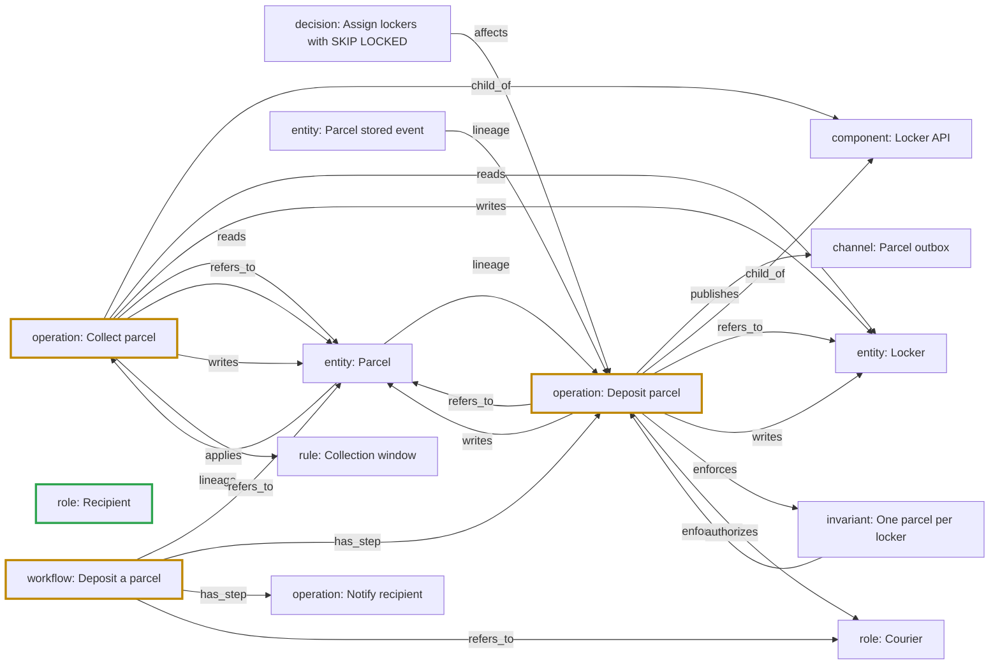

## Model changes

1 added, 0 removed, 3 modified (0 renamed or moved), 0 re-anchored, 12 unchanged.

### Added

- `role:recipient` Recipient

### Modified

- `operation:parcel.collect` Collect parcel
  - `$.relations[type=reads,target=entity:locker]`: — → {"target":"entity:locker","type":"reads"}
- `operation:parcel.deposit` Deposit parcel
  - `$.auth.authentication`: required → optional
  - `$.summary`: Assigns a free locker and stores the parcel. → Stores the parcel in a free locker.
- `workflow:deposit-parcel` Deposit a parcel
  - `$.steps[id=s2].plain`: Put the parcel in a free locker. → Put the parcel in the nearest free locker.

### Relations added

- `operation:parcel.collect` reads `entity:locker`

### Functional changes

- `workflow:deposit-parcel` `$.steps[id=s2].plain`

### Risk-relevant changes

- auth: `operation:parcel.deposit` `$.auth.authentication`

