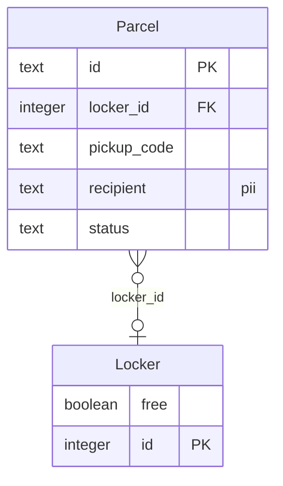
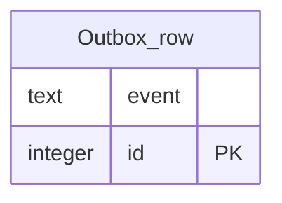
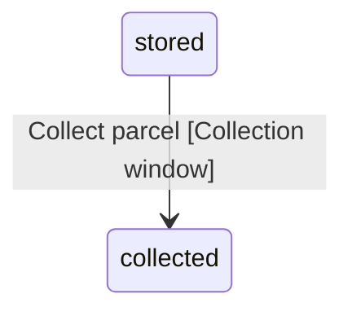

<!-- Generated by Evermap. Do not edit: run render instead. -->

# Data model

Persisted entities by datastore and the states of status fields. Back to the [index](README.md).

## Locker database

## No datastore recorded

## States

### Parcel `status`

