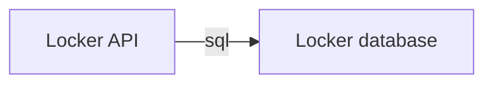

<!-- Generated by Evermap. Do not edit: run render instead. -->

# Locker database

`component:locker-db` · datastore

Relational store for lockers and parcels.

> Where lockers and parcels are recorded.

Evidence: [db/schema.sql:1-4](../../../db/schema.sql#L1-L4)

## Neighbourhood

## Data

| Entity | Type | Summary | Evidence |
| --- | --- | --- | --- |
| Locker `entity:locker` | table | One physical locker. | [db/schema.sql:1-4](../../../db/schema.sql#L1-L4) |
| Parcel `entity:parcel` | table | A parcel held in a locker. | [db/schema.sql:6-12](../../../db/schema.sql#L6-L12) |
