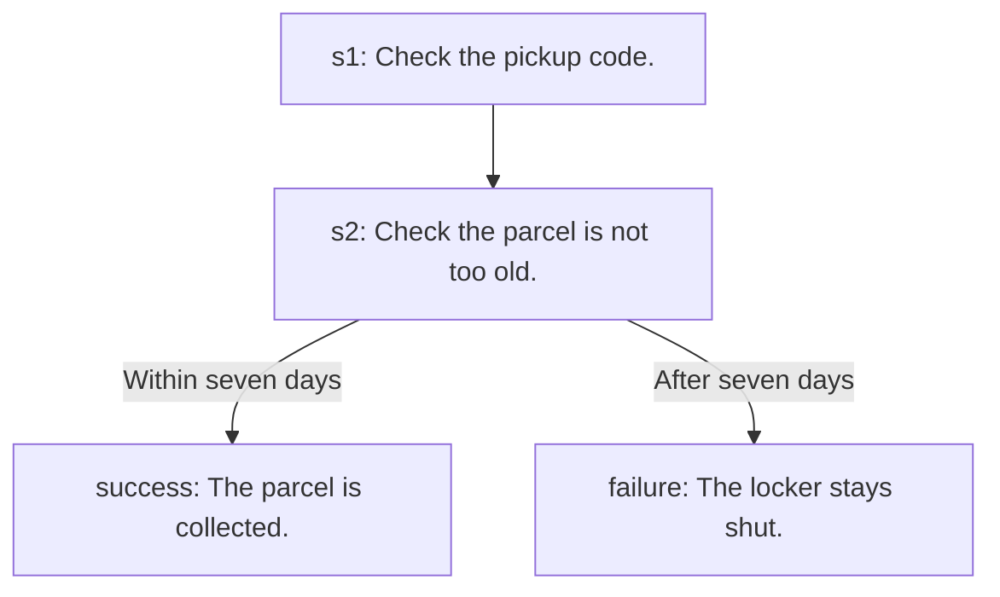
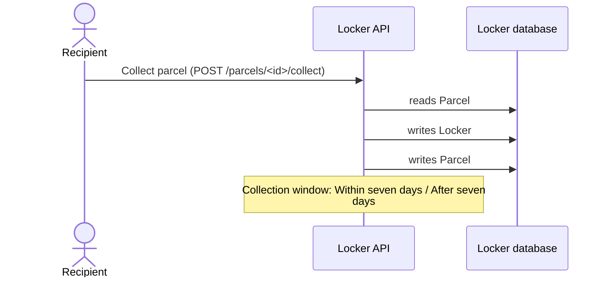

<!-- Generated by Evermap. Do not edit: run render instead. -->

# Collect a parcel

`workflow:collect-parcel`

From code entry to an open locker.

> How a recipient takes a parcel out of a locker.

Actors: `role:recipient` Recipient

Components: [Locker API](../technical/locker-api.md)

Evidence: [api/collect.py:10-17](../../../api/collect.py#L10-L17)

## Flow

## Sequence

## Steps

| Step | What happens | Operation | Rules | Evidence |
| --- | --- | --- | --- | --- |
| `s1` | Check the pickup code. | `operation:parcel.collect` Collect parcel in [Locker API](../technical/locker-api.md) | — | [api/collect.py:10-17](../../../api/collect.py#L10-L17) |
| `s2` | Check the parcel is not too old. | — | `rule:collection.window` Collection window | — |

## Outcomes

- `o-collected` success: The parcel is collected.
- `o-expired` failure: The locker stays shut.
