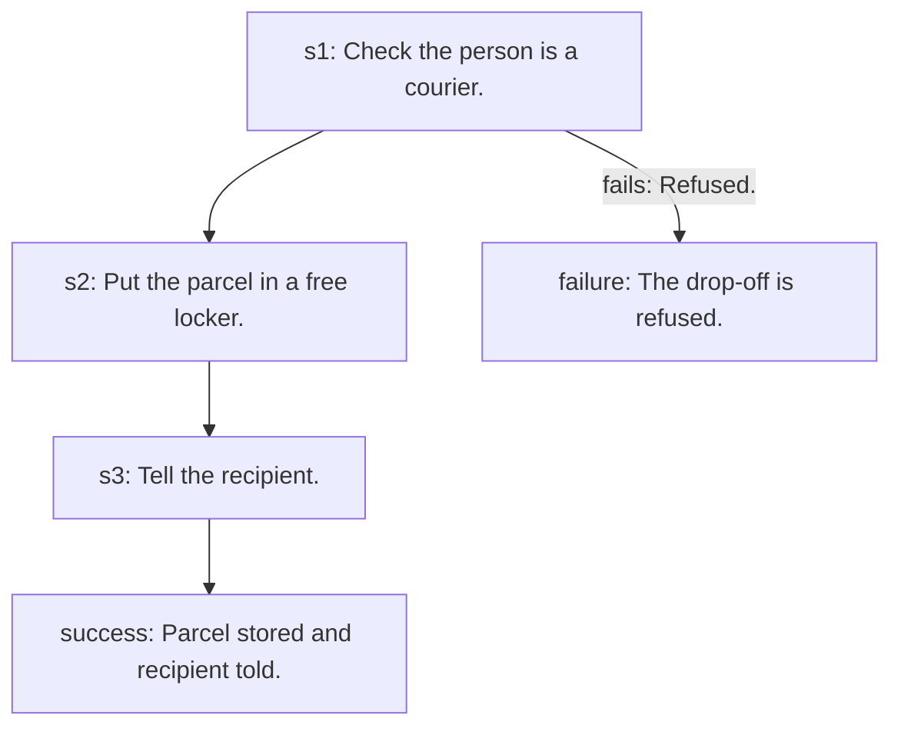
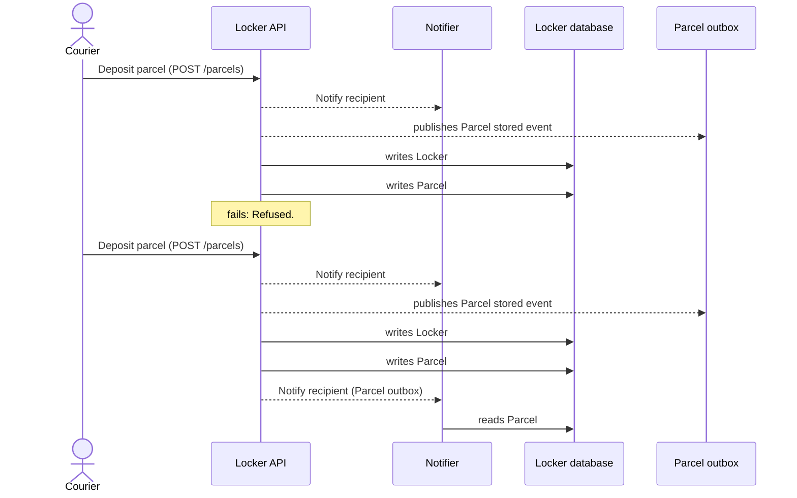

<!-- Generated by Evermap. Do not edit: run render instead. -->

# Deposit a parcel

`workflow:deposit-parcel`

From drop-off to notification.

> How a parcel gets into a locker and the recipient hears about it.

Trigger: A courier arrives with a parcel.

Actors: `role:courier` Courier

Components: [Locker API](../technical/locker-api.md), [Notifier](../technical/notifier.md)

Evidence: [api/deposit.py:4-12](../../../api/deposit.py#L4-L12)

## Flow

## Sequence

## Steps

| Step | What happens | Operation | Rules | Evidence |
| --- | --- | --- | --- | --- |
| `s1` | Check the person is a courier. | `operation:parcel.deposit` Deposit parcel in [Locker API](../technical/locker-api.md) | — | [api/deposit.py:4-12](../../../api/deposit.py#L4-L12) |
| `s2` | Put the parcel in a free locker. | `operation:parcel.deposit` Deposit parcel in [Locker API](../technical/locker-api.md) | — | [api/deposit.py:4-12](../../../api/deposit.py#L4-L12) |
| `s3` | Tell the recipient. | `operation:recipient.notify` Notify recipient in [Notifier](../technical/notifier.md) | — | [worker/notify.py:4-6](../../../worker/notify.py#L4-L6) |

## Outcomes

- `o-stored` success: Parcel stored and recipient told.
- `o-denied` failure: The drop-off is refused.
