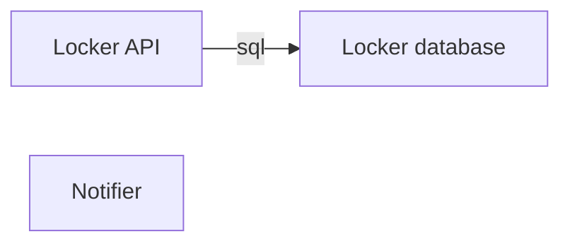

<!-- Generated by Evermap. Do not edit: run render instead. -->
<!-- evermap:render-hash sha256:<hash> -->

# Parcel lockers

Locker deposits and collection.

> Holds parcels until people pick them up.

Describes commit `<commit>`.

## Contents

| Kind | Elements |
| --- | --- |
| component | 3 |
| operation | 3 |
| entity | 3 |
| channel | 1 |
| workflow | 1 |
| rule | 1 |
| invariant | 1 |
| role | 1 |
| decision | 1 |

## Components

| Component | Type | Summary |
| --- | --- | --- |
| [Locker API](technical/locker-api.md) | service | HTTP service for deposits and collection. |
| [Locker database](technical/locker-db.md) | datastore | Relational store for lockers and parcels. |
| [Notifier](technical/notifier.md) | worker | Worker that consumes stored-parcel events. |

## Context

## Coverage

This model is selective. Something that is not listed here may still exist in the code.
