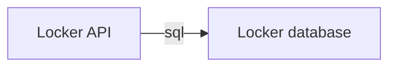
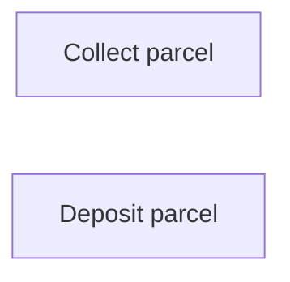

<!-- Generated by Evermap. Do not edit: run render instead. -->

# Locker API

`component:locker-api` · service · python

HTTP service for deposits and collection.

> Lets couriers drop parcels off and recipients pick them up.

Evidence: [api/routes.py:6-8](../../../api/routes.py#L6-L8)

## Responsibilities

- Deposits
- Collection

## Neighbourhood

## Operation calls

No operation here calls another operation in the model.

## Workflows

- [Deposit a parcel](../workflows/deposit-parcel.md)

## Operations

| Operation | Trigger | Exposure | Authentication | Transactions | Idempotency | Evidence |
| --- | --- | --- | --- | --- | --- | --- |
| Collect parcel `operation:parcel.collect` | http `POST /parcels/<id>/collect` | public | none | not assessed | not assessed | [api/collect.py:10-17](../../../api/collect.py#L10-L17) |
| Deposit parcel `operation:parcel.deposit` | http `POST /parcels` | public | required | `db.transaction` | none-detected *(inferred)* | [api/deposit.py:4-12](../../../api/deposit.py#L4-L12) |

## Relations

| From | Relation | To | Condition | Provenance |
| --- | --- | --- | --- | --- |
| `component:locker-api` | depends\_on | `component:locker-db` Locker database | — | as source |
| `operation:parcel.collect` | applies | `rule:collection.window` Collection window | — | as source |
| `operation:parcel.collect` | reads | `entity:parcel` Parcel | — | as source |
| `operation:parcel.collect` | writes | `entity:locker` Locker | — | as source |
| `operation:parcel.collect` | writes | `entity:parcel` Parcel | — | as source |
| `operation:parcel.deposit` | publishes | `channel:parcel-outbox` Parcel outbox | — | as source |
| `operation:parcel.deposit` | writes | `entity:locker` Locker | — | as source |
| `operation:parcel.deposit` | writes | `entity:parcel` Parcel | — | as source |

## Configuration (names only)

| Name | Kind | Purpose |
| --- | --- | --- |
| `DATABASE_URL` | env | Database location |
