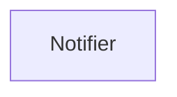
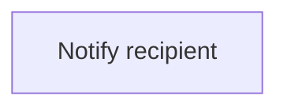

<!-- Generated by Evermap. Do not edit: run render instead. -->

# Notifier

`component:notifier` · worker

Worker that consumes stored-parcel events.

> Tells recipients their parcel has arrived.

Evidence: [worker/notify.py:4-6](../../../worker/notify.py#L4-L6)

## Neighbourhood

No dependency or operation call links this component to another one in the model.

## Operation calls

No operation here calls another operation in the model.

## Workflows

- [Deposit a parcel](../workflows/deposit-parcel.md)

## Operations

| Operation | Trigger | Exposure | Authentication | Transactions | Idempotency | Evidence |
| --- | --- | --- | --- | --- | --- | --- |
| Notify recipient `operation:recipient.notify` | message `channel:parcel-outbox` | internal | not assessed | not assessed | not assessed | [worker/notify.py:4-6](../../../worker/notify.py#L4-L6) |

## Relations

| From | Relation | To | Condition | Provenance |
| --- | --- | --- | --- | --- |
| `operation:recipient.notify` | consumes | `channel:parcel-outbox` Parcel outbox | — | as source |
| `operation:recipient.notify` | reads | `entity:parcel` Parcel | — | as source |
